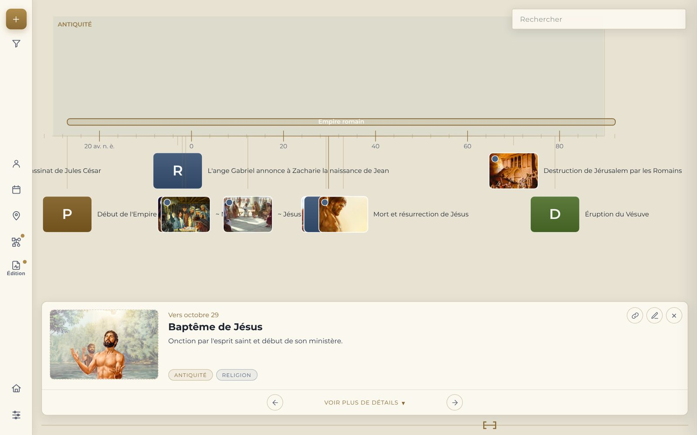
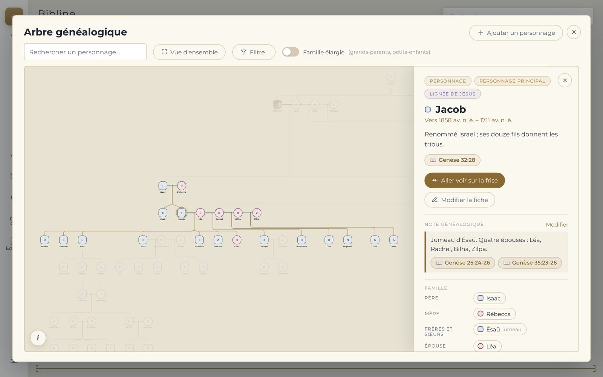
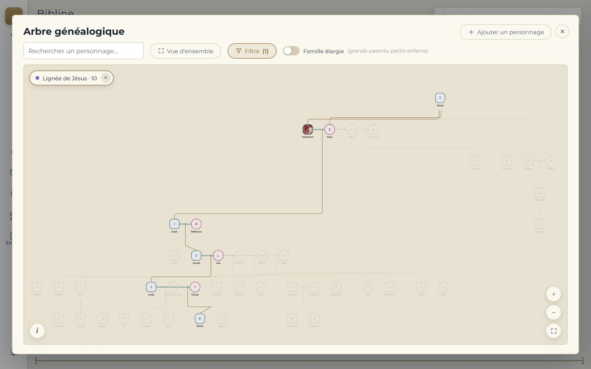
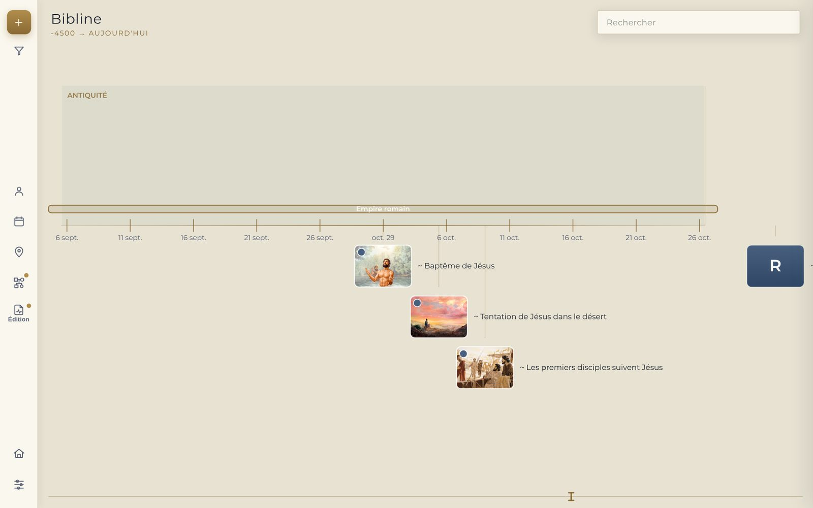
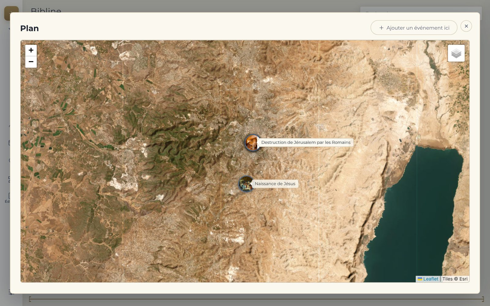
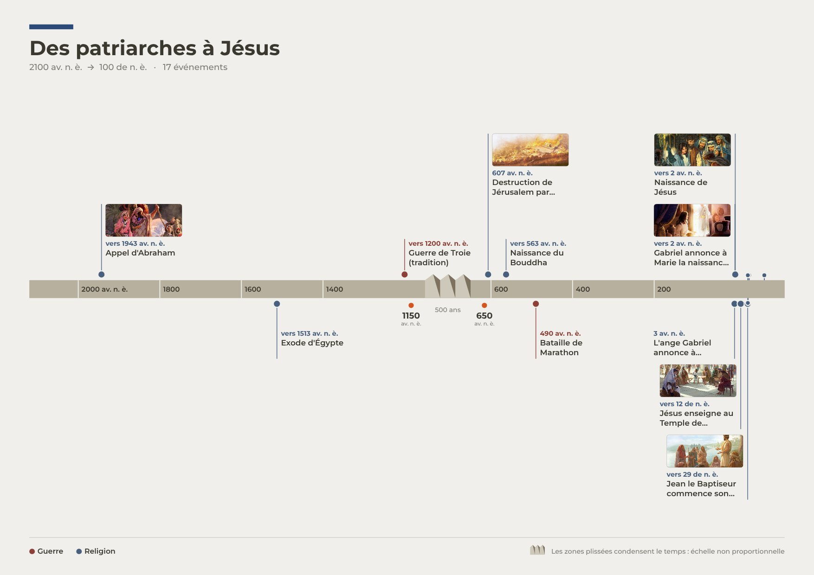
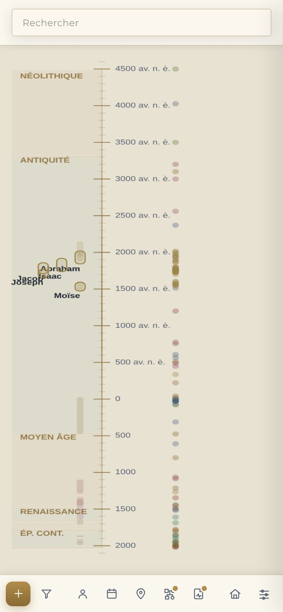
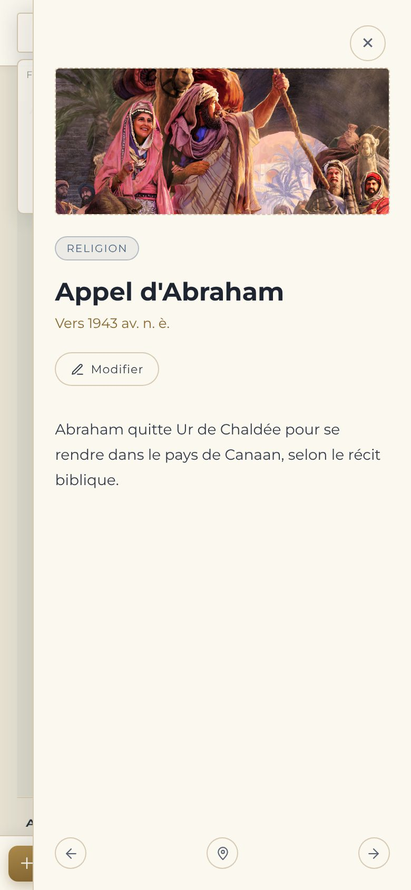
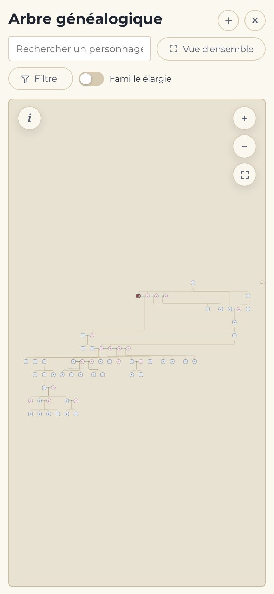

  

<h1 align="center">Bibline</h1>

  <b>Frise chronologique biblique interactive</b> 
  Parcourir plus de 6 000 ans d'histoire avec la même fluidité qu'une carte géographique.

  
  
  
  
  

  <a href="https://mathieu-p12.github.io/Bibline/"><b>▶ Ouvrir Bibline</b></a>
  &nbsp;·&nbsp;
  <a href="https://github.com/Mathieu-P12/Bibline/wiki"><b>📖 Lire le tutoriel</b></a>

  

---

## Présentation

**Bibline** est une application web de gestion de connaissances chronologiques, centrée sur l'histoire biblique. Elle permet de créer, consulter et enrichir une frise qui s'étend de **-4500 à aujourd'hui**, en y rattachant des images, des descriptions, des références bibliques, des sources et des lieux.

L'idée de départ est simple : on navigue sur une carte en zoomant et en glissant, pourquoi pas sur le temps ? D'un coup d'œil sur les millénaires, un pincement suffit pour descendre jusqu'à l'année, au mois, voire au jour d'un événement.

> La chronologie des événements bibliques suit la chronologie traditionnelle telle que présentée sur [jw.org](https://www.jw.org).

## Fonctionnalités

| | |
|---|---|
| 🔍 **Frise zoomable** | Du millénaire au jour, à la souris, au doigt ou par pincement, avec des graduations qui s'adaptent. [Naviguer →](https://github.com/Mathieu-P12/Bibline/wiki/Naviguer-sur-la-frise) |
| 🗂️ **Fiches riches** | Dates précises ou approximatives, description, note, image, source, lieu, plusieurs catégories. [Les fiches →](https://github.com/Mathieu-P12/Bibline/wiki/Les-fiches) |
| 📖 **Références bibliques** | Un verset s'ouvre dans JW Library, ou sur jw.org ; il est reconnu aussi au fil des notes. |
| 🔎 **Recherche** | Un titre, une année (`-3200`), un verset : la frise se centre sur le résultat. [Rechercher →](https://github.com/Mathieu-P12/Bibline/wiki/Rechercher-et-filtrer) |
| 🗺️ **Plan** | Une carte du monde où chaque événement a son lieu ; un clic sur la carte pré-remplit les coordonnées. [Le plan →](https://github.com/Mathieu-P12/Bibline/wiki/Le-plan) |
| 🌳 **Arbre généalogique** | 60 personnages de Térah à Moïse, leurs liens de parenté et des filtres par lignée. [L'arbre →](https://github.com/Mathieu-P12/Bibline/wiki/Arbre-g%C3%A9n%C3%A9alogique) |
| 🖨️ **Mode édition** | Composer une vue de la frise et l'exporter en PDF, PNG ou JPG. [Exporter →](https://github.com/Mathieu-P12/Bibline/wiki/Mode-%C3%A9dition-et-export) |
| 💾 **Vos données chez vous** | Sauvegarde automatique sur l'appareil, partage par simple fichier. [Sauvegarder →](https://github.com/Mathieu-P12/Bibline/wiki/Sauvegarder-et-%C3%A9changer) |
| 📱 **Installable, hors ligne** | Application web (PWA) pour ordinateur, Android et iPhone. [Installer →](https://github.com/Mathieu-P12/Bibline/wiki/Mobile-et-hors-ligne) |
| 🌗 **Confort** | Mode clair ou sombre, interface en français, anglais, espagnol et chinois. |

## Aperçu

### L'arbre généalogique

| Le volet d'un personnage | Une lignée mise en avant |
|:---:|:---:|
|  |  |
| Dates, description, note généalogique, références bibliques et liens de parenté cliquables. | Le filtre met en avant une lignée ; les autres personnages restent visibles, en retrait. |

### Du millénaire au jour près, et sur la carte

| Frise au jour près | Plan |
|:---:|:---:|
|  |  |
| Graduations au jour, vignettes illustrées, fiche à portée de clic. | De près, chaque événement apparaît avec sa photo ; un clic ramène sur la frise. |

### Exporter une vue

  

Le bouton **Édition** compose une planche à partir de la frise (période, catégories, éléments, images, plis qui condensent les siècles sans événement) ; elle s'exporte en PDF, PNG ou JPG. Ci-dessus, le fichier réellement obtenu.

### Sur téléphone

| Frise | Fiche | Arbre |
|:---:|:---:|:---:|
|  |  |  |

## Démarrer

Aucune installation technique : Bibline s'ouvre dans un navigateur, sans compte.

1. Ouvrez **[mathieu-p12.github.io/Bibline](https://mathieu-p12.github.io/Bibline/)**
2. Pour l'installer comme une application :
   - **Chrome / Edge (ordinateur)** : icône d'installation dans la barre d'adresse
   - **Android** : menu ⋮ → *Ajouter à l'écran d'accueil*
   - **iPhone / iPad (Safari)** : bouton Partager → *Sur l'écran d'accueil*
3. Une fois installée, l'application fonctionne sans connexion (les fonds de carte restent en ligne).

Pas à pas, avec captures d'écran : **[le tutoriel](https://github.com/Mathieu-P12/Bibline/wiki/Premiers-pas)**.

## Documentation

Le **[Wiki](https://github.com/Mathieu-P12/Bibline/wiki)** est le mode d'emploi complet, une page par fonctionnalité. Depuis l'application, **Paramètres → Aide et tutoriels** y mène directement.

| Pour… | Page |
|---|---|
| Découvrir l'écran et les boutons | [Premiers pas](https://github.com/Mathieu-P12/Bibline/wiki/Premiers-pas) |
| Ajouter et organiser le contenu | [Ajouter et modifier un élément](https://github.com/Mathieu-P12/Bibline/wiki/Ajouter-et-modifier-un-%C3%A9l%C3%A9ment) · [Les catégories](https://github.com/Mathieu-P12/Bibline/wiki/Les-cat%C3%A9gories) |
| Régler l'application | [Paramètres](https://github.com/Mathieu-P12/Bibline/wiki/Param%C3%A8tres) |
| Dépanner | [Questions fréquentes](https://github.com/Mathieu-P12/Bibline/wiki/Questions-fr%C3%A9quentes) |
| Héberger sa copie, comprendre le code | [Pour les développeurs](https://github.com/Mathieu-P12/Bibline/wiki/Pour-les-d%C3%A9veloppeurs) |

## Outils utilisés

Aucun serveur, aucun compte, aucune étape de compilation : du HTML, du CSS et du JavaScript.

| Brique | Rôle |
|---|---|
| **Canvas 2D** | Moteur de rendu de la frise : seuls les éléments visibles sont dessinés |
| **[Dexie.js](https://dexie.org)** | Stockage local persistant (IndexedDB) |
| **[Leaflet](https://leafletjs.com)** + OpenStreetMap / Esri | Carte interactive |
| **SVG** | Arbre généalogique : placement calculé, liens tracés, zoom et déplacement |
| **Export PNG / JPG / PDF** | Planche dessinée sur un canvas ; PDF d'une page assemblé à la main, sans bibliothèque |
| **Service Worker** | Cache de l'application pour le fonctionnement hors ligne |

## Feuille de route

- [x] Moteur de frise canvas avec zoom adaptatif jusqu'au jour
- [x] Carte interactive et ajout d'événements depuis la carte
- [x] Application installable, hors ligne, sauvegarde automatique
- [x] Export / import avec images
- [x] Plusieurs catégories par élément
- [x] Références bibliques ouvertes dans JW Library
- [x] Arbre généalogique des personnages, relié à la frise
- [x] Catégories livrées avec l'arbre (personnages principaux, lignées, tribus) et filtre par catégorie
- [x] Mode édition : composer une vue et l'exporter en PDF, PNG ou JPG
- [x] Wiki : tutoriel complet avec captures d'écran
- [ ] Stockage dans un dossier du disque, synchronisable via un service cloud
- [ ] Application Android native

## À propos

Bibline est conçue par **Mathieu**, qui en porte la vision, le design et les retours d'usage. Le code a été écrit de façon itérative avec [Claude](https://claude.ai), l'assistant d'Anthropic.

Les noms et abréviations des livres bibliques proviennent du module Obsidian
[JW Library Linker](https://github.com/msakowski/obsidian-library-linker) (licence Apache 2.0).

Idées, remarques, bugs : ouvrez une [issue](../../issues).
