<p align="center">
  
</p>

<h1 align="center">Bibline</h1>

<p align="center">
  <b>Frise chronologique biblique interactive</b><br>
  Parcourir plus de 6 000 ans d'histoire avec la même fluidité qu'une carte géographique.
</p>

<p align="center">
  <a href="https://mathieu-p12.github.io/Bibline/"></a>
  
  
  
</p>

<p align="center">
  <a href="https://mathieu-p12.github.io/Bibline/"><b>▶ Ouvrir Bibline</b></a>
</p>

<p align="center">
  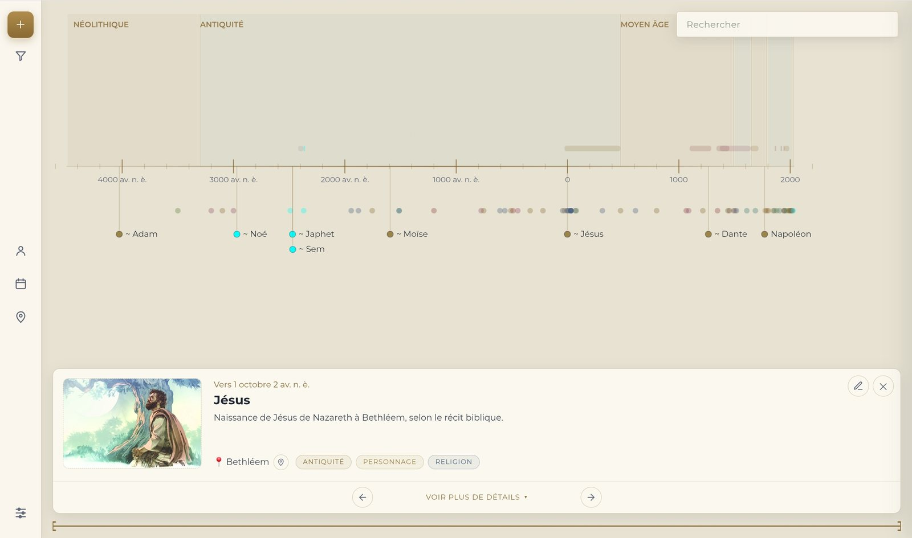
</p>

---

## Présentation

**Bibline** est une application web de gestion de connaissances chronologiques, centrée sur l'histoire biblique. Elle permet de créer, consulter et enrichir une frise qui s'étend de **-4500 à aujourd'hui**, en y rattachant des images, des descriptions, des références bibliques, des sources et des lieux.

L'idée de départ est simple : on navigue sur une carte en zoomant et en glissant, pourquoi pas sur le temps ? D'un coup d'œil sur les millénaires, un pincement suffit pour descendre jusqu'à l'année, au mois, voire au jour d'un événement.

> La chronologie des événements bibliques suit la chronologie traditionnelle telle que présentée sur [jw.org](https://www.jw.org).

## Aperçu

### Du millénaire… au jour près

| Vue d'ensemble | Zoom au jour près |
|:---:|:---:|
| 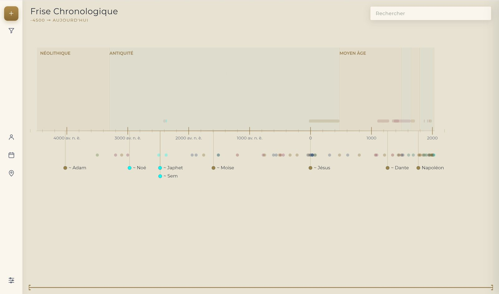 | 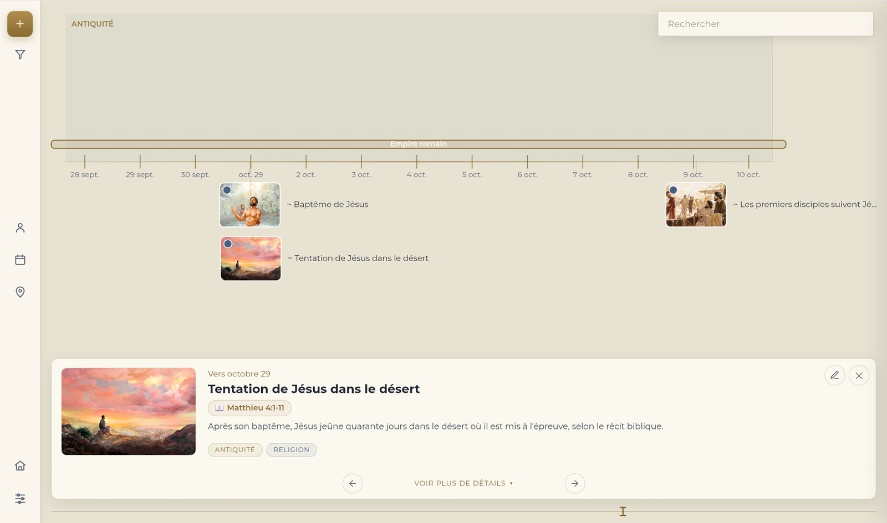 |
| Les époques en arrière-plan, les personnages mis en avant, le reste en retrait pour garder une vue lisible. | Graduations au jour, vignettes illustrées et fiche avec sa référence biblique cliquable. |

### Des fiches riches

| Fiche développée | Ajout d'un élément |
|:---:|:---:|
| 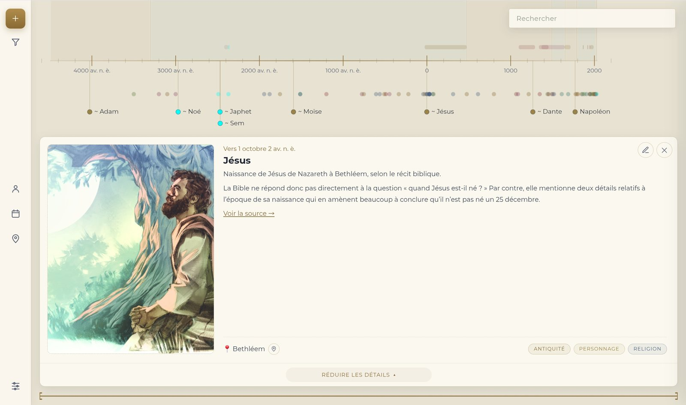 | 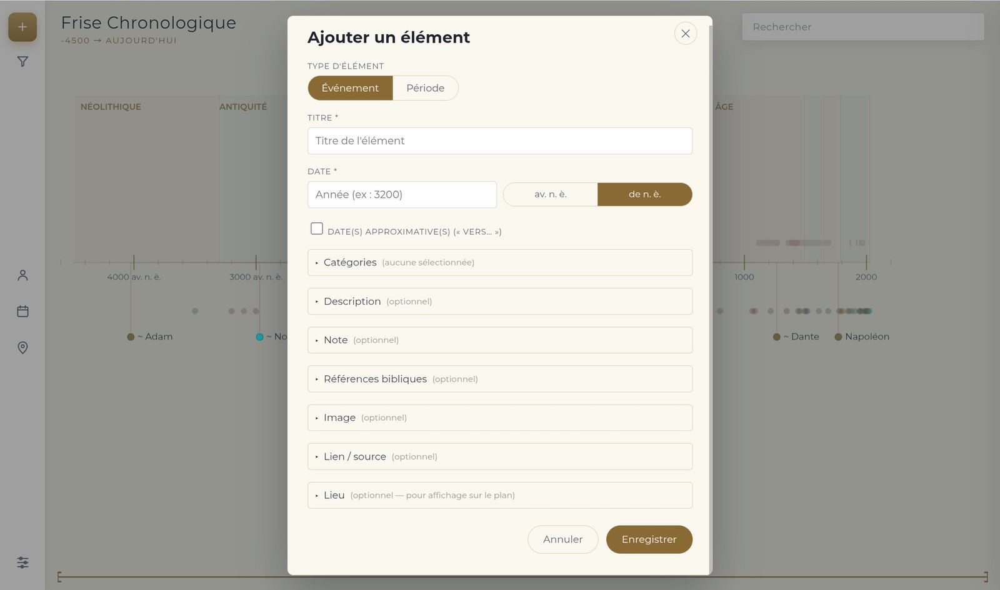 |
| Image, description, note, source, lieu et catégories multiples. | Formulaire en sections repliables : seul l'essentiel est visible au départ. |

### La carte

| Vue du monde | Vue rapprochée |
|:---:|:---:|
| 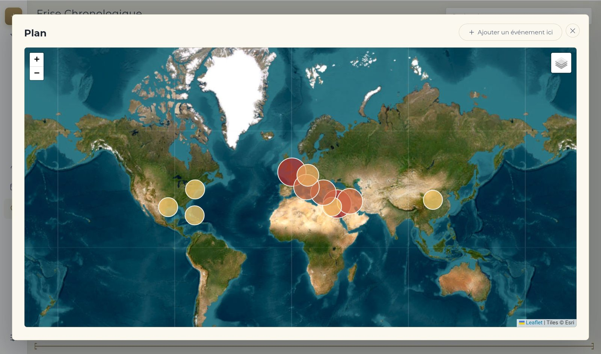 | 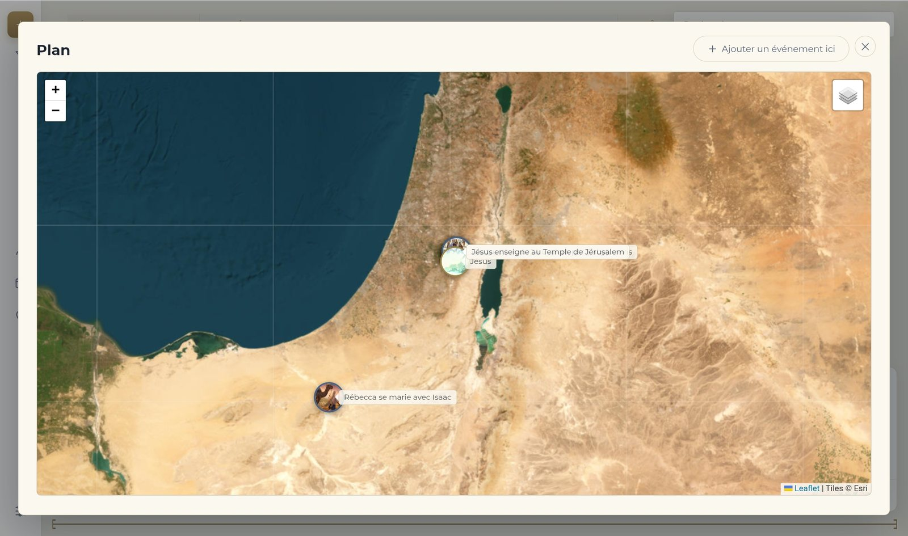 |
| De loin, des bulles de densité montrent où se concentre l'histoire. | De près, chaque événement apparaît avec sa photo ; un clic ramène sur la frise. |

### Listes, filtres et réglages

| Personnages | Toutes les dates |
|:---:|:---:|
| 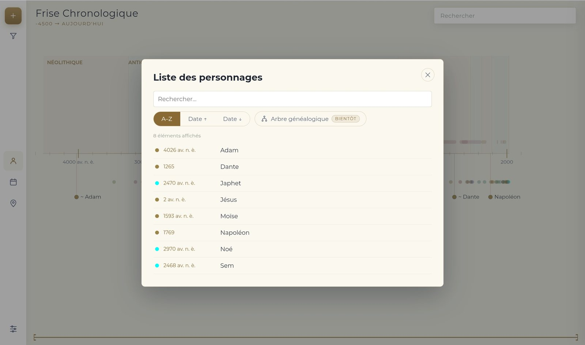 | 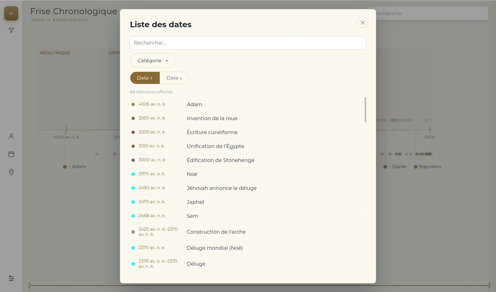 |

| Filtres par catégorie | Paramètres |
|:---:|:---:|
| 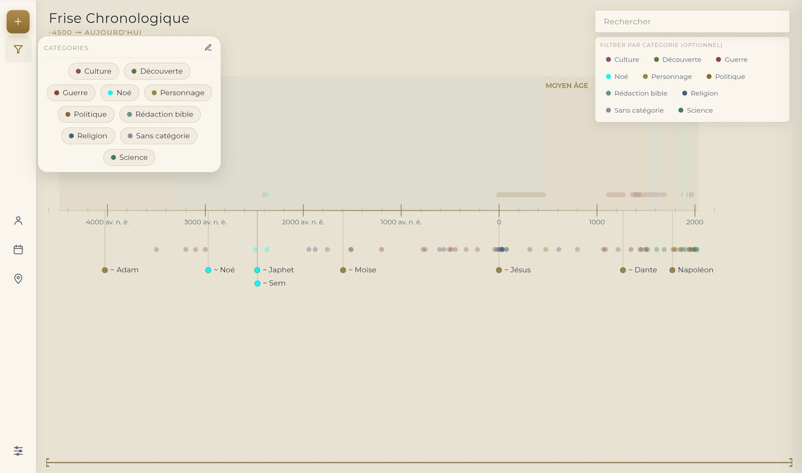 | 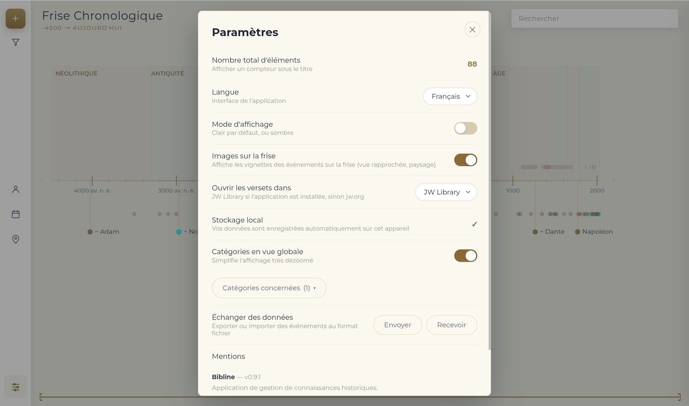 |

### Exporter une vue

<p align="center">
  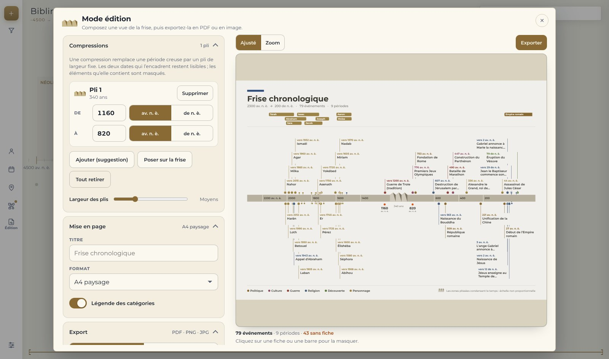
</p>

Le bouton **Édition** de la barre latérale ouvre une fenêtre où l'on compose une vue de la frise : réglages à gauche, aperçu fidèle à l'export à droite. Ici, de 2300 av. n. è. à 200, avec un pli qui condense les siècles sans événement.

## Fonctionnalités

### Navigation dans le temps
- **Zoom et déplacement fluides** à la souris, à la molette, au doigt ou par pincement, avec inertie
- **Graduations adaptatives** : millénaires → siècles → années → mois → jours
- **Bandes d'époques** (Néolithique, Antiquité, Moyen Âge…) et **barres de périodes** empilées sans chevauchement
- **Vue globale simplifiée** : en fort dézoom, seules les catégories choisies restent au premier plan (au départ : les personnages principaux, pour alléger l'affichage)
- **Vignettes illustrées** sur la frise en vue rapprochée (désactivables)
- **Mini-carte** en bas de l'écran pour situer la portion affichée et y sauter d'un clic
- **Mise en page double** : paysage sur grand écran, portrait sur téléphone, la fiche ouverte suivant la rotation de l'appareil

### Contenu
- **Événements et périodes**, dates avant ou après notre ère, précises ou approximatives (« vers… »), jusqu'à l'heure près
- **Plusieurs catégories par élément** (ex. Moïse → Personnage, Personnage principal, Lignée lévite)
- **Références bibliques** qui ouvrent le verset dans **JW Library**, ou sur jw.org si l'application n'est pas installée
- **Versets reconnus dans les notes** : écrire « Gen 3:15 » au fil d'une note suffit, le passage devient cliquable
- **Liens internet affichés en mention compacte** dans les notes, à la manière de Notion
- **Description, note personnelle, image** (fichier ou lien, avec cadrage), **source** et **lieu**
- **Catégories personnalisables** : couleur, nom, création à la volée
- **Listes** des personnages et de toutes les dates, avec recherche, filtre et tri
- **Personnages reliés en famille** : un personnage est un élément de la frise ; ses liens de parenté sont conservés à part, dans l'arbre généalogique

### Recherche
- Recherche instantanée, filtrable par catégorie
- Saisie d'une année (`1789`, `-3200`, `3200 av`) pour sauter directement à cette date
- Recherche aussi dans les références bibliques des éléments
- La frise se centre automatiquement sur le résultat choisi

### Carte
- Fond **satellite** ou **plan** (OpenStreetMap)
- Trois niveaux d'affichage selon le zoom : densité, pastilles par catégorie, photos avec libellés
- **« Ajouter un événement ici »** : un clic sur la carte pré-remplit les coordonnées

### Arbre généalogique
- **Un bouton dans la barre latérale** (et un autre dans la liste des personnages) ouvre l'arbre dans une fenêtre, comme le plan
- **Tous les personnages d'un coup d'œil** : carré = homme, rond = femme, rond en pointillés = non renseigné ; les unions entre proches parents sont tracées en double trait
- **Toucher un personnage** met sa famille en évidence et recentre la vue ; son volet donne photo, dates, description, **note généalogique avec références bibliques** et liens de parenté cliquables
- **Filtre par catégorie** : le bouton « Filtre » met en avant les personnages d'une ou plusieurs catégories (la lignée de Jésus, les 12 tribus…) ; les autres restent visibles, très en retrait, comme lorsqu'on touche une famille. Une pastille rappelle le filtre en cours et se retire d'un clic ; toucher une personne l'emporte sur le filtre, dont les autres membres restent à mi-intensité
- **« Aller voir sur la frise »** est le seul bouton qui quitte l'arbre ; dans l'autre sens, la fiche d'un personnage sur la frise propose **« Voir dans l'arbre »**
- **Ajout depuis l'arbre** : père, mère, conjoint ou enfant d'un personnage existant, ou personnage libre ; il devient aussi un élément de la catégorie « Personnage » de la frise (date de naissance obligatoire)
- **Contenu de départ** : 60 personnages de Térah à Moïse et leurs familles, aux dates approximatives (à vérifier), installés une seule fois ; un personnage déjà saisi sous le même nom n'est pas doublé
- **Catégories de départ** : **Personnage principal** (Abraham, Isaac, Jacob, Joseph, Moïse), **Lignée de Jésus** (de Térah à Pérez, mères comprises), **Lignée lévite** (de Lévi à Moïse, Aaron et leurs fils) et **12 Tribus** (les douze fils de Jacob). Elles s'ajoutent à la catégorie « Personnage » et se renomment, se recolorent ou se suppriment comme les autres

### Mode édition : exporter une vue en PDF ou en image
- **Un bouton « Édition »** dans la barre latérale ouvre une fenêtre pour composer une vue de la frise, puis l'exporter en **PDF, PNG ou JPG**
- **Période** : date de début et de fin (avant ou après notre ère), saisies à la main ou par raccourcis (période affichée, toute la frise, une époque)
- **Catégories** à garder ou non ; les barres de périodes se retirent d'un seul interrupteur
- **Masquer des éléments** : un clic sur une fiche ou une barre dans l'aperçu, ou une case dans la liste (avec recherche) ; un message permet d'annuler
- **Images** affichées ou non ; une image qui ne peut pas être chargée (hors connexion, site qui la refuse) laisse la fiche sans image, avec un bouton « Réessayer »
- **Compressions temporelles** : un pli remplace une période creuse par une zone de largeur fixe, pour rapprocher deux moments éloignés ; il se propose tout seul ou se pose en deux clics sur l'aperçu
- **Mise en page** : titre, A4 ou A3 paysage ou écran 16:9, qualité standard ou haute (jusqu'à environ 300 dpi), légende facultative
- **Sur ordinateur**, le fichier se télécharge directement ; **sur téléphone**, il passe par la feuille de partage du système (« Enregistrer dans Fichiers »…)
- Les réglages sont mémorisés sur l'appareil ; la frise elle-même n'est jamais modifiée

### Données et confort
- **Fonctionne hors ligne** : application installable (PWA)
- **Sauvegarde automatique** sur l'appareil à chaque modification
- **Export / import** par catégorie, images incluses, avec les liens familiaux des personnages exportés
- **Mode clair / sombre**
- Interface en **français, anglais, espagnol et chinois**

## Installation

Aucune installation technique : Bibline s'ouvre dans un navigateur.

1. Ouvrez **[mathieu-p12.github.io/Bibline](https://mathieu-p12.github.io/Bibline/)**
2. Pour l'installer comme une application :
   - **Chrome / Edge (ordinateur)** : icône d'installation dans la barre d'adresse
   - **Android** : menu ⋮ → *Ajouter à l'écran d'accueil*
   - **iPhone / iPad (Safari)** : bouton Partager → *Sur l'écran d'accueil*
3. Une fois installée, l'application fonctionne sans connexion (les fonds de carte restent en ligne).

### Héberger votre propre copie

1. Forkez ce dépôt
2. Dans **Settings → Pages**, choisissez la branche `main` et le dossier racine `/`
3. Votre copie sera disponible sur `https://<votre-compte>.github.io/<nom-du-dépôt>/`

## Sauvegarder et partager ses données

Les données restent **sur votre appareil**. Pour les sauvegarder ou les transférer, ouvrez **Paramètres → Échanger des données** :

| Bouton | Effet |
|---|---|
| **Envoyer** | Télécharge un fichier contenant les éléments des catégories choisies, leurs images et, pour les personnages, leurs liens familiaux |
| **Recevoir** | Ajoute les éléments d'un fichier à votre frise, sans écraser l'existant ; les personnages reçus sont reliés entre eux comme dans le fichier |

## Sous le capot

| Brique | Rôle |
|---|---|
| **Canvas 2D** | Moteur de rendu de la frise : seuls les éléments visibles sont dessinés |
| **[Dexie.js](https://dexie.org)** | Stockage local persistant (IndexedDB) |
| **[Leaflet](https://leafletjs.com)** + OpenStreetMap / Esri | Carte interactive |
| **SVG** | Arbre généalogique : placement calculé, liens tracés, zoom et déplacement |
| **Export PNG / JPG / PDF** | Planche dessinée sur un canvas ; PNG et JPG natifs, PDF d'une page assemblé à la main (aucune bibliothèque) |
| **Service Worker** | Cache de l'application pour le fonctionnement hors ligne |

Aucun serveur, aucun compte, aucune dépendance à installer : du HTML, du CSS et du JavaScript.

```
├── index.html              Structure de la page : écrans, fenêtres, champs
├── styles.css              Apparence : couleurs, polices, mise en page, mode sombre
├── app.js                  Fonctionnement : frise, recherche, formulaires, carte, stockage
├── arbre.js                Arbre généalogique : placement, liens, volet, filtre, ajout de personnages
├── edition.js              Mode édition : composition d'une vue, aperçu, export PDF / PNG / JPG
├── bible-books.js          Les 66 livres de la Bible et leurs abréviations (FR · EN · ES)
├── data.json               Contenu livré avec l'application
├── manifest.json           Déclaration de l'application installable
├── sw.js                   Service worker (cache hors ligne)
├── icon-192.png            Icônes de l'application
├── icon-512.png
├── icon-512-maskable.png
└── docs/                   Logo et captures de ce README
```

L'ordre de chargement compte : `bible-books.js`, `arbre.js` et `edition.js` sont lus avant `app.js`, qui s'en sert.
Si `arbre.js` ou `edition.js` manquait, la frise fonctionnerait quand même : seuls les boutons concernés
(l'arbre, l'édition) disparaîtraient.

### Deux bases, un identifiant

Un personnage est un **élément ordinaire de la frise** (catégorie « Personnage ») : nom, dates, photo,
description, références. Un événement s'il est placé à sa naissance, une période naissance → décès si
son décès est connu. Ce que la frise ne sait pas dire — sexe, note généalogique, liens père / mère /
conjoint / enfants — est conservé à part, dans la table `meta` de la base locale (clé `genealogie`),
et ne renvoie aux éléments que par leur identifiant. Supprimer un personnage de la frise retire donc
ses liens de l'arbre, sans rien casser d'autre.

### Les catégories livrées avec l'arbre

Elles sont déclarées dans `arbre.js` : `SEED_CATS` (nom, couleur) et `SEED_TAGS` (quels personnages du
contenu de départ en font partie). Elles sont créées et attribuées **une seule fois par appareil**
(l'étape atteinte est mémorisée dans `state.init`, comparée à `SEED_VERSION`) :

- on ajoute seulement, jamais on ne retire ni n'écrase : une catégorie déjà créée à la main sous la même
  clé est réutilisée telle quelle, et un personnage supprimé ou renommé n'est simplement pas reconnu ;
- une catégorie supprimée ensuite ne revient pas, puisque l'étape n'est jamais rejouée.

Pour livrer plus tard de nouvelles catégories (Prophètes, Rois…) : compléter `SEED_CATS` et `SEED_TAGS`,
ajouter une étape dans `seedIfNeeded` (`if(state.init < 3){ … state.init = 3; }`) et passer `SEED_VERSION`
à 3. Les appareils déjà à jour la recevront une fois, les autres enchaîneront les étapes.

Le réglage « Catégories en vue globale » est posé au départ sur **Personnage** avec la condition
**Personnage principal** (`PRINCIPAL_KEY` dans `app.js`). Un appareil dont ce réglage n'avait jamais été
touché est migré une fois (`overviewDefaultsV`) ; un réglage personnalisé n'est jamais modifié, et une
condition qui renvoie à une catégorie supprimée est simplement ignorée.

### Le mode édition

Le mode édition ne fait que **lire** la frise : au démarrage, `app.js` lui remet un petit objet
(`editionApi`) qui donne accès aux éléments, aux catégories, à la vue affichée et à la langue.
`edition.js` n'écrit jamais dans la base de l'appareil ; ses propres réglages (période, catégories,
éléments masqués, plis, format…) sont gardés à part, dans le stockage du navigateur, sous la clé
`bibline-edition`.

- **Un seul dessin** sert à l'aperçu et aux fichiers (`renderSheet`, sur une feuille de 1000 unités de
  large) : ce que l'on voit est exactement ce qui est exporté.
- **Les plis** découpent l'échelle du temps en morceaux (`buildScale`) : l'échelle est proportionnelle
  entre deux plis, et chaque pli a une largeur fixe.
- **Les images** venues d'un autre site « salissent » un canvas, et le navigateur refuse alors d'en
  tirer un fichier. Chacune est donc chargée par `fetch` (mode CORS), recopiée en version réduite, puis
  dessinée. Si le site refuse, ou sans connexion, la fiche est exportée sans image.
- **Le PDF** est écrit à la main : une page qui contient la planche en JPEG. Aucune bibliothèque,
  donc rien de plus à charger hors ligne.
- **La taille** des fichiers (A4 ou A3, 150 ou 300 dpi) est plafonnée à 16 millions de pixels, ce
  que les téléphones savent produire.

### Mettre une nouvelle version en ligne

1. Remplacer les fichiers modifiés à la racine du dépôt
2. **Changer `CACHE_VERSION` dans `sw.js`** (par exemple `bibline-v0.11.1`)

Le second point est le seul vraiment indispensable : il efface l'ancien cache et force le
téléchargement groupé de tous les fichiers. Sans lui, un appareil pourrait garder un ancien
`app.js` à côté d'un nouveau `index.html`. Si un fichier manque lors de la mise en ligne, les
autres sont tout de même mis en cache et la console du navigateur nomme celui qui manque.
Un nouveau fichier de code (comme `edition.js`) doit aussi être ajouté à la liste `APP_SHELL` de
`sw.js`, faute de quoi il ne serait pas disponible hors ligne.

Deux noms techniques gardent volontairement une ancienne appellation : la base locale
(`FriseChronologiqueDB`) et la clé des réglages (`frise-settings`). Les renommer donnerait un code
plus coquet et viderait la frise de chaque appareil : un autre nom, c'est une autre base, vide.

### Le contenu de départ (`data.json`)

Il n'est installé qu'au tout premier lancement sur un appareil, quand la base locale est encore
vide. Ensuite, c'est la base de l'appareil qui fait foi : modifier `data.json` ne touche jamais aux
événements déjà saisis.

Ce fichier a exactement le format des exports de l'application. Pour le régénérer : **Paramètres →
Échanger des données → Envoyer**, puis renommer le fichier obtenu en `data.json`.

## Feuille de route

- [x] Moteur de frise canvas avec zoom adaptatif jusqu'au jour
- [x] Carte interactive et ajout d'événements depuis la carte
- [x] Application installable, hors ligne, sauvegarde automatique
- [x] Export / import avec images
- [x] Plusieurs catégories par élément
- [x] Références bibliques ouvertes dans JW Library
- [x] **Arbre généalogique** des personnages, relié à la frise
- [x] Catégories livrées avec l'arbre (personnages principaux, lignées, tribus) et **filtre par catégorie**
- [x] **Mode édition** : composer une vue (période, catégories, éléments masqués, images, compressions temporelles) et l'exporter en PDF, PNG ou JPG
- [ ] Stockage dans un dossier du disque, synchronisable via un service cloud
- [ ] Application Android native

## À propos

Bibline est conçue par **Mathieu**, qui en porte la vision, le design et les retours d'usage. Le code a été écrit de façon itérative avec [Claude](https://claude.ai), l'assistant d'Anthropic.

Les noms et abréviations des livres bibliques proviennent du module Obsidian
[JW Library Linker](https://github.com/msakowski/obsidian-library-linker) (licence Apache 2.0).

Idées, remarques, bugs : ouvrez une [issue](../../issues).
